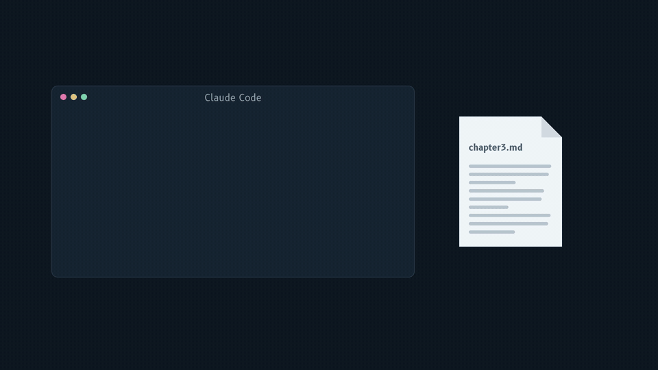

# claude-undo

Local recovery copies for supported Claude Code changes, in folders with or without git.



(21-second video with sound: [docs/demo.mp4](docs/demo.mp4))

Claude Code is great at editing files. It is also happy to `rm` the wrong one or run `sed -i` across a folder you never committed. `claude-undo` is a small hook that attempts to copy eligible existing files before supported tool calls, plus commands to inspect and recover saved versions:

```bash
claude-undo list ~/thesis
claude-undo restore ~/thesis/chapter3.md
```

One Python file, standard library only. Claude Undo itself makes no network requests; copies are stored in your configured filesystem location. This does not make Claude Code offline or prevent its model requests from sending project context to your configured provider. See [Claude Code data usage](https://code.claude.com/docs/en/data-usage).

## Why not /rewind?

Claude Code's built-in checkpoints are good, but by design they leave gaps ([Claude Code docs, Checkpointing](https://code.claude.com/docs/en/checkpointing)):

| Situation | `/rewind` | `claude-undo` |
|---|---|---|
| Edit and Write tool changes | yes | eligible existing files, when copying succeeds |
| `rm`, `mv`, `cp`, `sed -i`, `perl -i`, `truncate`, `tee`, `>` on a file Claude never edited with its file tools | no | selected file-level forms; exclusions apply |
| Copies after the session is closed | until the retention sweep, about 30 days by default | 90 days by default, configurable |
| Folders without git | yes | yes |

Git is still the best undo. This is for everything that is not in git yet: a thesis, notes, a client folder, a quick prototype.

## Install

Requires Python 3.9 or newer and macOS or Linux.

```bash
git clone https://github.com/BanoForge/claude-undo.git ~/claude-undo
python3 ~/claude-undo/claude_undo.py install
```

`install` adds one `PreToolUse` hook to `~/.claude/settings.json` (a copy of the old file is kept next to it as `settings.json.before-claude-undo`). Restart Claude Code afterwards. Run it again and nothing changes.

The hook points at the folder you cloned into. If you move that folder, run `uninstall` and then `install` with the script at its new location. Until you do, the hook does nothing (it never blocks Claude Code).

Optional shortcut:

```bash
alias claude-undo="python3 ~/claude-undo/claude_undo.py"
```

## Use

```bash
claude-undo list                         # last 30 copies, newest first
claude-undo list ~/thesis -n 100         # only files under a folder
claude-undo diff ~/thesis/notes.md       # what changed since the newest copy
claude-undo restore ~/thesis/notes.md    # put back the newest copy
claude-undo restore ~/thesis/notes.md --id 20261026-123028-363384
claude-undo status                      # recent recorded hook errors, not a coverage guarantee
claude-undo clean --days 30              # delete old copies now
```

A restore first saves an existing regular destination file, then atomically replaces it with the validated copy. Running restore twice can recover the displaced contents. It does not undo recovery back to a deleted state, remove a newly created file, or reverse a whole move operation.

Copies live in `~/.claude-undo/`. To select another store, set `CLAUDE_UNDO_DIR` in the environment of both Claude Code and the CLI; setting it only for install does not persist the choice or move old copies. Cleanup removes copies older than 90 days by default, at most once a day when the hook runs.

### Restore safety and integrity

Restore refuses symlinks (including dangling links), symlinked parent paths, hard-linked destinations, directories and special files. Use the original regular-file path; inspect paths before retrying an error. An intentionally symlinked parent, including an operating-system path alias, is also refused. New parent directories can be recreated for a deleted file.

New backups record their byte size and SHA-256 digest. Restore and diff reject missing, truncated or checksum-mismatched copies with a nonzero exit code and a clear error. Failed staging, metadata copying, current-version backup or atomic replacement does not leave a partially restored destination. Current contents are saved before replacement. File bytes, permission bits and timestamps are copied; ownership, ACLs and other extended metadata are not guaranteed.

Old backups have no recorded checksum. They remain listed, but restore and diff refuse them by default. After independently inspecting a legacy copy, you can explicitly opt into size-only verification:

```bash
claude-undo restore ~/thesis/notes.md --id OLD_ID --allow-unverified
claude-undo diff ~/thesis/notes.md --id OLD_ID --allow-unverified
```

The override cannot bypass size or checksum mismatches and does not certify old contents. No automatic checksum migration is performed. Keep independent backups, including before recovery of important files.

Save, restore, list, diff and cleanup coordinate through the same POSIX filesystem lock; a busy store times out with an error rather than proceeding unlocked. Save and cleanup commit the index atomically, so cleanup cannot discard a simultaneously saved entry. Pause old Claude sessions while updating, then restart: older script processes do not participate in this lock. Use a local filesystem with working POSIX locks and atomic rename. This is not a power-loss durability guarantee or protection against unrelated software changing paths or the store concurrently.

## What it catches, and what it does not

Caught, for files that exist at the moment of the call:

- `Edit`, `Write`, `NotebookEdit`
- Shell commands that name the file: `rm` (and `rm -r` on a folder), `mv`, `cp` onto an existing file, `sed -i`, `perl -i`, `truncate`, `tee` without `-a`, and `>` redirects. Globs like `*.md` and a leading `cd folder &&` are understood.

Not caught, because the hook cannot see which files they will touch:

- scripts (`python fix.py`, `npm run clean`), `find ... -delete`, `xargs rm`, paths inside variables
- changes made outside Claude Code

Also not covered: new-file creation, symlink targets, append-only `>>` and `tee -a`, recursive copies, directory moves, and unrecognized flags or shell grammar. Known parser gaps include multiline commands, subshell/failed-`cd` path changes, quoted literal glob characters such as `a[1].txt`, and combined sed flags such as `-Ei`. Supported command names do not imply support for every form.

Skipped on purpose (edit `~/.claude-undo/config.json` to change):

| Setting | Default |
|---|---|
| `keep_days` | 90 |
| `max_file_mb` | 5 |
| `max_dir_files` | 200 eligible files across the entire Bash call; exceeding this skips the whole call |
| `exclude_dirs` | `.git`, `node_modules`, `.venv`, `venv`, `__pycache__`, `dist`, `build`, `.next`, `.cache` |
| `exclude_names` | `.env`, `.env.local`, `.env.production`, `.DS_Store` |
| `exclude_suffixes` | `.lock`, `.pyc` |
| `exclude_prefixes` | `/tmp`, `/private/tmp`, `/var/folders`, `/private/var/folders` |

Only the exact `.env` names above are excluded by default; other secret-bearing files, such as `.env.staging`, can be copied. These filters are not secret detection or restrictions on Claude's access.

The installed hook never blocks Claude Code and emits no instructions: failed backups still let the original tool call proceed. Failures are recorded on a best-effort basis in the store's `errors.jsonl`; `status` shows up to 30 recent recorded errors and exits 1 if that history is nonempty. It does not clear history, verify every backup, or prove current protection. If the store is unwritable, the script is missing, or the process is killed, an error may not be recorded. The installed shell command still suppresses stderr and returns success. Verify recovery in a disposable project after setup or relocation.

Malformed configuration or index data produces a clear CLI error instead of silently discarding entries. If cleanup commits its index but cannot delete an expired blob, it reports the partial cleanup explicitly; the orphan may remain on disk. Process interruption can also leave unindexed staging files. Do not infer restore coverage from filesystem copies or exit status alone.

## Uninstall

```bash
python3 ~/claude-undo/claude_undo.py uninstall
rm -r ~/.claude-undo ~/claude-undo
```

## Tests

```bash
python3 -m unittest discover -s tests -v
```

## License

MIT
